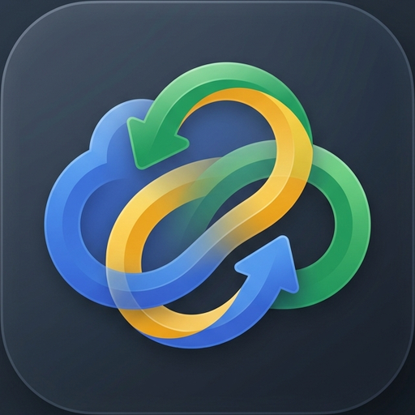

<div align="center">
  
  <h1>🔄 Sync Drive</h1>
  <p><b>Mirror Android device folders to Google Drive with resilient, background multi-thread sync</b></p>

[](https://developer.android.com)
[-blue.svg)](https://developer.android.com/about/versions/oreo)
[](https://kotlinlang.org)
[](LICENSE)
[](https://github.com/adityakumar027/Sync-Drive/releases/latest)

</div>

A robust, private Android application that **mirrors your device folders to Google Drive** with exact folder structures preserved. Features **resumable chunked uploads**, **4 simultaneous upload workers**, **in-place file updates for zero duplicates**, **smart file filtering**, **Light/Dark modes**, and **customizable background scheduling**.

Built to solve the #1 problem with lightweight sync apps: **large files (>20 MB) silently failing** due to single-POST timeouts, OS process kills, or Google Drive API rate limits.

---

## ✨ Key Features

### 🚀 Resilient Upload Engine
- **Resumable chunked uploads**: Uploads in 8 MB chunks; if interrupted, resumes from the last byte without restarting from scratch.
- **Direct upload optimization**: Files under 5 MB use direct multipart upload for maximum speed.
- **No file size limit**: Handles multi-GB video archives, large ZIP files, and camera dumps.
- **Exponential backoff**: Automatically retries (1s → 2s → 4s → 8s → 16s, up to 60s) on HTTP 403 (Rate Limits), HTTP 429 (Too Many Requests), and 5xx server errors.
- **Automatic OAuth token refresh**: Smoothly refreshes expired access tokens on HTTP 401 Unauthorized mid-transfer.

### ⚡ 4-Thread Simultaneous Engine
- **4 concurrent upload workers**: Multiple files upload simultaneously over high-speed networks.
- **Real-time slot dashboard**: Live visual indicators for Slot 0..3 with active file name, byte transfers, and progress bars.
- **Background execution safety**: Optimized for Android 12, 13, and 14 (`targetSdk 34`), preventing `ForegroundServiceStartNotAllowedException` crashes.
- **Completion notifications**: Live status updates and background finish summaries in your notification tray.

### 🧠 Smart Deduplication & Data Consistency
- **In-place file updates**: If a file already exists on Drive, Sync Drive updates it in-place rather than generating duplicate copies.
- **Batch folder verification**: Fetches folder contents from Drive in bulk and caches them in memory for $O(1)$ lookups.
- **Fast re-sync**: Synced files are recorded in SQLite, allowing subsequent re-scans of tens of thousands of files to complete in seconds.

### 🔍 Smart File & Media Filtering
- **Preserves hidden media**: Even if photos, audio, videos, or documents are named with a leading dot (`.private_photo.jpg`, `.voice_memo.mp3`) or are inside private/hidden vault folders, Sync Drive **detects and uploads them**.
- **Folders with `.nomedia`**: Folders hidden from the gallery app are fully scanned and synced.
- **System cache & chunk exclusion**: Automatically filters out Android gallery thumbnail caches (`.thumbnails/`), OS trash (`.trashed/`), app caches (`.cache/`, `Android/data/`), and temporary chunk files (`.chunk`, `.tmp`, `.part`).

### ⏰ Interactive Periodic Background Sync
- **Live ON/OFF Switch**: Instantly toggle background synchronization on or off.
- **Customizable Intervals**: Choose from **Every 1 hour**, **3 hours**, **6 hours**, **12 hours**, or **24 hours (Daily)**.
- **Network Constraints**: Run on **Any Network (WiFi + Mobile Data)** or restrict to **WiFi Only**.

### 🎨 Modern Material 3 UI & Dark Mode
- **Light & Dark Theme Switcher**: Tap the theme button in the top toolbar to choose between ☀️ **Light Mode**, 🌙 **Dark Mode**, or 🌓 **System Default**.
- **Built-in Folder Browser**: Easily pick any folder on internal storage without getting blocked by Android Scoped Storage restrictions.
- **Smart Link Parser**: Paste raw Google Drive URLs or folder IDs; the app extracts the ID automatically.

---

## 📥 Download & Quick Start

Sync Drive is ready to use out-of-the-box on any Android device (Android 8.0+ / API 26+).

### 1. Download & Install
Download the latest APK directly onto your Android device:

👉 **[Download SyncDrive v1.3.0 APK](https://github.com/adityakumar027/Sync-Drive/releases/download/v1.3.0/SyncDrive-v1.3.apk)**

*(Or download `SyncDrive.apk` from the [Latest GitHub Release](https://github.com/adityakumar027/Sync-Drive/releases/latest)).*

---

### 2. Sign In with Google
1. Open **Sync Drive** on your device.
2. Tap **"Sign In with Google"** and choose your Google account.
3. *First-time sign-in:* Since this app communicates directly with your Google Drive using your personal credentials, you will see a *"Google hasn't verified this app"* screen. Tap **Advanced** → **Go to Sync Drive (unsafe)** → **Allow**.

---

### 3. Grant Storage Access
Tap **"Grant Storage Access"** when prompted to allow the app to discover and mirror your selected folders.

---

### 4. Configure Sync Folders
1. Tap **"+ Add Sync Folder"**.
2. Pick any local directory on your phone (e.g., `DCIM/Camera`, `Documents`, `Music`, `Download`).
3. Enter your destination **Google Drive Folder ID** or paste the full Drive folder URL:
   ```
   https://drive.google.com/drive/folders/1A2B3C4D5E6F7G8H...
                                          ^^^^^^^^^^^^^^^^
   ```
4. Tap **"Sync Now"** for an immediate backup, or switch on **"Periodic Background Sync"** to let the app backup automatically!

---

## 🏗️ Architecture Deep-Dive

Sync Drive is architected around Android Jetpack components and Google's official Drive API v3 client library:

```
┌─────────────────────────────────────────────────────────────────┐
│                           UI LAYER                              │
│   MainActivity (Dashboard & Tabs)  •  ThemeManager              │
│   SyncPairDetailActivity          •  SyncHistoryActivity        │
└────────────────────────────────┬────────────────────────────────┘
                                 │ Observes LiveData & Triggers Work
┌────────────────────────────────▼────────────────────────────────┐
│                   WORKMANAGER ORCHESTRATION                     │
│   Manual Sync ("manual_sync")  •  Periodic Sync ("daily_sync")  │
│                SyncWorker (CoroutineWorker)                     │
└───────────┬────────────────────┬────────────────────┬───────────┘
            │                    │                    │
┌───────────▼──────────┐ ┌───────▼──────────┐ ┌───────▼───────────┐
│    LOCAL STORAGE     │ │  LOCAL DATABASE  │ │   GOOGLE DRIVE    │
│     FileScanner      │ │   Room SQLite    │ │   Drive API v3    │
│  • Smart Media Filter│ │   • sync_pairs   │ │ DriveFolder-      │
│  • Directory Walker  │ │   • synced_files │ │   Resolver        │
│                      │ │   • sync_logs    │ │ DriveUpload-      │
│                      │ │                  │ │   Manager         │
└──────────────────────┘ └──────────────────┘ └───────────────────┘
```

### Module Breakdown

| Class / File | Responsibility |
|---|---|
| [`DriveUploadManager.kt`](app/src/main/java/com/example/drivesyncfix/DriveUploadManager.kt) | **Core upload engine.** Handles `MediaHttpUploader` chunked uploads, in-place updates via `files().update()`, exponential backoff handlers, and HTTP 401 token refreshes. |
| [`SyncWorker.kt`](app/src/main/java/com/example/drivesyncfix/SyncWorker.kt) | **Sync orchestrator.** Jetpack `CoroutineWorker` running on `Dispatchers.IO`. Dispatches 4 parallel upload coroutines via Kotlin channels with background safety. |
| [`DriveFolderResolver.kt`](app/src/main/java/com/example/drivesyncfix/DriveFolderResolver.kt) | **Drive folder tree mirroring.** Lazily creates nested Drive folders to match local directories, and batch-fetches remote folder contents to cache Drive file IDs. |
| [`FileScanner.kt`](app/src/main/java/com/example/drivesyncfix/FileScanner.kt) | **Smart local file discovery.** Traverses directories, includes valid user photos/audios/docs (even if hidden), and ignores gallery thumbnail caches, system junk, and temporary chunks. |
| [`SyncDatabase.kt`](app/src/main/java/com/example/drivesyncfix/SyncDatabase.kt) | **Room SQLite persistence.** Manages folder pairs (`sync_pairs`), file synchronization records (`synced_files`), and audit logs (`sync_logs`). |
| [`AuthManager.kt`](app/src/main/java/com/example/drivesyncfix/AuthManager.kt) | **Authentication.** Google Sign-In (`play-services-auth`) and background OAuth2 access token generation via `GoogleAuthUtil`. |
| [`ThemeManager.kt`](app/src/main/java/com/example/drivesyncfix/ThemeManager.kt) | **Theme management.** Manages Light, Dark, and System Default theme modes with persistent `SharedPreferences`. |
| [`MainActivity.kt`](app/src/main/java/com/example/drivesyncfix/MainActivity.kt) | **Main UI.** Real-time slot progress display, folder management, theme selection, and periodic sync card. |

---

### Sync Lifecycle (Every Sync Execution)

1. **Phase 1: Local Scan**: `FileScanner` traverses your selected local folders. User photos, audios, videos, and documents are queued, while thumbnail caches and temporary files are filtered out.
2. **Phase 2: Remote Batch Verification**: `DriveFolderResolver` queries Google Drive in batch pages (up to 1,000 files/page). Each local file is compared against the Drive listing and the local `synced_files` database:
   - **Exact Match** (Same size & timestamp): **Skipped** (0 bytes transferred).
   - **File Exists with Changes**: Queued for **in-place update** (`existingDriveId`).
   - **New File**: Queued for **new upload**.
3. **Phase 3: 4-Worker Parallel Upload**: Tasks are fed into an asynchronous channel. 4 coroutines upload concurrently, streaming byte progress to Slots 0–3.
4. **Phase 4: SQLite Commit**: Once Google Drive confirms the upload with an HTTP 200 and issues a committed file ID, the record is immediately committed to SQLite.

---

## 🛠️ Step-by-Step Guide: Building from Source Code

Anyone can build this app from source code using standard free tools. Follow these steps:

### 1. Prerequisites
- **JDK 17**: Required to compile modern Kotlin and Android Gradle Plugin 8.x.
  - *macOS (Homebrew)*: `brew install openjdk@17`
  - *Ubuntu/Debian*: `sudo apt install openjdk-17-jdk`
  - *Windows*: Download from [Adoptium Temurin 17](https://adoptium.net/temurin/releases/?version=17)
- **Android SDK** (API 34) or **Android Studio Hedgehog+**.
- **Git** installed on your system.

---

### 2. Clone the Repository
```bash
git clone https://github.com/adityakumar027/Sync-Drive.git
cd Sync-Drive
```

---

### 3. Set Up Your Free Google Cloud OAuth Credentials
Because this app does not bundle private API keys, you create your own free Google Cloud client:

1. Visit the [Google Cloud Console](https://console.cloud.google.com/).
2. Create a new project (e.g., `"My Sync Drive"`).
3. In the sidebar, go to **APIs & Services** → **Library**, search for **Google Drive API**, and click **Enable**.
4. Go to **APIs & Services** → **OAuth consent screen**:
   - User Type: **External**.
   - App name: `Sync Drive`.
   - Enter your email address.
   - Under **Test Users**, add your personal Google account email.
5. Go to **APIs & Services** → **Credentials** → **Create Credentials** → **OAuth client ID**:
   - Application Type: **Android**.
   - Package name: `com.example.drivesyncfix`
   - **SHA-1 certificate fingerprint**: Get this from your computer's debug keystore by running:
     ```bash
     keytool -list -v -keystore ~/.android/debug.keystore -alias androiddebugkey -storepass android -keypass android
     ```
     *(On Windows: `%USERPROFILE%\.android\debug.keystore`)*.
   - Copy the `SHA1` fingerprint and paste it into the Google Cloud Console. Click **Save**.

---

### 4. Build the APK

Run the Gradle wrapper:

* **macOS / Linux**:
  ```bash
  ./gradlew assembleDebug
  ```
* **Windows (Command Prompt / PowerShell)**:
  ```cmd
  gradlew.bat assembleDebug
  ```

Once compilation completes, your APK is generated at:
```
app/build/outputs/apk/debug/app-debug.apk
```

---

### 5. Install on Your Device

- **Via ADB (Command Line)**:
  ```bash
  adb install -r app/build/outputs/apk/debug/app-debug.apk
  ```
- **Manual**: Transfer `app-debug.apk` to your phone via USB cable, Google Drive, or messaging app, and tap to install!

---

## 🔒 Privacy & Security

- **Direct-to-Drive**: Data transfers directly from your device to your personal Google Drive account. No intermediate proxy servers or third-party databases.
- **Zero Analytics**: No telemetry, crash reporters, or advertising trackers.
- **Minimal Permissions**: The `MANAGE_EXTERNAL_STORAGE` permission is used strictly to read the folders you explicitly designate for backup.

---

## 📋 Tech Stack

| Component | Technology |
|---|---|
| **Language** | Kotlin 1.9+ |
| **Minimum SDK** | Android 8.0 (API 26) |
| **Target SDK** | Android 14 (API 34) |
| **UI Framework** | Material Design 3 + ViewBinding |
| **Cloud Storage** | Google Drive API v3 (Official Java Client) |
| **Authentication** | Google Sign-In (`play-services-auth`) |
| **Background Scheduling** | Android Jetpack `WorkManager` (Foreground & Periodic) |
| **Local Database** | Jetpack `Room` (SQLite) |
| **Concurrency** | Kotlin Coroutines (`Dispatchers.IO`) + Channels |

---

## 📄 License

This project is licensed under the MIT License — see the [LICENSE](LICENSE) file for details.
